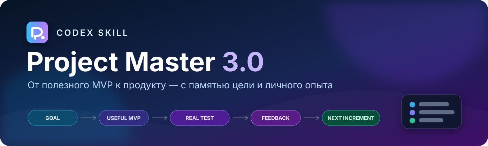

<div align="center">
  
</div>

<p align="center">
  <a href="https://github.com/Sovetov-AS/project-master/actions/workflows/ci.yml"></a>
  
  
  
  <a href="LICENSE"></a>
</p>

<p align="center"><strong>От небольшого полезного MVP к полноценному продукту — без потери цели и личного опыта.</strong></p>

Project Master — USER-level Codex skill для долгой разработки приложений, плагинов и агентов. Общий механизм работает во всех проектах, но память и обучение каждого владельца остаются локальными.

## Что изменилось в 3.0

- Goal-first recovery: цель, стратегия, текущий increment и применимые уроки восстанавливаются после compaction раньше списка задач.
- STANDARD с первого запуска: один рассмотренный план ближайшего MVP; полный lifecycle только при реальной сложности.
- BUILD для рабочей версии продукта; OPERATE для повторяющейся работы с измеримым результатом, источником и периодом.
- Личная обратная связь, профессиональная экспертиза и measured results становятся проверяемой проектной памятью. Гипотезы не подменяют знания владельца.
- Редактируемые .drawio карты взаимодействия skills/компонентов: данные, STOP, причина, затронутая ветка, условие продолжения. BPMN — опция, не обязательная картинка lifecycle.
- Возможности продукта отделены от разрешений на конкретные live/paid/production действия. Отсутствие разрешения на запуск не запрещает разработать и протестировать полноценную функцию.
- Обычная correction — короткий лог и тест. Scope change — компактный proposal/evidence; ясное текущее поручение не требует повторной формулы approval.
- Lock + optimistic concurrency + write-ahead journal защищают STATE; private MISSION имеет revision, checksum и атомарное сохранение.
- Progress-aware plan snapshots; semantic hash drawio не зависит от layout. Явная backed-up миграция 2.1 → 3.0 сохраняет решения и историю.

## Путь малого продукта

Цель → минимальный полный сценарий → реальный тест → feedback → следующая возможность.

Держим направление «для владельца → переносимый продукт → возможное отдельное приложение», но не строим заранее SaaS. Каждый increment содержит outcome, check, extension seam и not-now.

| Режим | Готовность |
|---|---|
| BUILD | Рабочий сценарий, acceptance criteria, сохранённые проверки и owner acceptance |
| OPERATE | Измеримый outcome с target, period, freshness, источником и evidence; один успешный запуск не завершает цель |

Профили: QUICK — correction; STANDARD — MVP/increment; FULL — сложные взаимосвязи; CRITICAL — конкретный рискованный пакет. Наличие рекламного API не превращает все задачи проекта в CRITICAL.

## Быстрый старт

Новая установка (если каталог уже существует — не клонируйте поверх него):

```bash
git clone --branch v3.0.0 https://github.com/Sovetov-AS/project-master.git \
  "$HOME/.agents/skills/project-master"
```

В проекте:

```text
$project-master start Небольшой агент для выбранного рабочего сценария
$project-master resume
$project-master status
```

Для уже открытого чата явно попросите прочитать обновлённый SKILL.md и выполнить recovery. Обновление файла не доказывает, что чат уже загрузил новый текст. При отсутствии skill в списке доступных — откройте новую задачу/перезапустите клиент по его инструкции.

Скрипты Python 3.9+, только стандартная библиотека, без production-зависимостей:

```bash
python3 scripts/init_project.py --root /path/to/project --idea "Рабочий сценарий"
python3 scripts/recover.py --root /path/to/project
python3 scripts/mission.py --root /path/to/project show
python3 scripts/validate_project.py --root /path/to/project
```

Bootstrap помечает неизвестные цели/критерии NEEDS_REVIEW. Сначала уточните миссию через mission.py revise, затем утверждайте план. Никто не выдаёт шаблон за согласованную цель.

## Память и персональное обучение

```text
Общий skill                         Конкретный проект
SKILL.md / references / scripts      .project-master/STATE.yaml + event history
Синтетические templates              private/MISSION.json — цель, стратегия,
НЕТ данных пользователей            измерения, экспертиза, feedback, lessons
                                    requirements / roadmap / active contract
                                    optional workflows/*.drawio
```

[Память цели и обучения](references/goal-memory.md): definition revisions, immutable observations и уроки с происхождением/областью/решением. ADOPTED не равен «модель решила», а результат с изменённым evidence перестаёт быть VERIFIED. Старый период не становится свежим от повторного чтения.

Это адаптация рабочего подхода по памяти, **не переобучение весов GPT**. Нет автоматического переноса ваших уроков другим пользователям, телеметрии или публикации данных. Private каталог Git-ignored; это не шифрование и не защита от force-add/уже tracked файлов. Публичный пакет публикуйте по явному списку файлов; секреты не храните в lessons.

## Рабочая карта продукта

[Редактируемый пример плагина](assets/templates/WORKFLOW-plugin-example.drawio) · [Контракт и редактирование](references/interaction-map.md)

Открывайте .drawio в diagrams.net / совместимом редакторе. Узлы и стрелки имеют стабильные ID, данные и stop metadata; перемещать и редактировать можно визуально. Пример синтетический: все узлы PLANNED.

```bash
python3 scripts/workflow.py validate assets/templates/WORKFLOW-plugin-example.drawio --strict
python3 scripts/workflow.py inspect /path/to/project/.project-master/workflows/plugin.drawio
python3 scripts/workflow.py compare new.drawio --baseline previous.drawio
```

Validator ищет разорванные handoffs, отсутствующих producers, недостижимые outcomes, unbounded retries, STOP без resume condition и любой обход AUTHORIZATION gate к внешней WRITE. Не исполняет карту, не доказывает соответствие коду/бизнес-результат и не заменяет runtime authorization.

Старые BPMN не удаляются. [BPMN инструменты](references/process-modeling.md) остаются для проектов, которым они нужны.

## Миграция существующих проектов

Обновление общего skill **не мигрирует все проекты автоматически**.

```bash
python3 scripts/upgrade.py --root /path/to/project plan
python3 scripts/upgrade.py --root /path/to/project apply \
  --mission /private/path/reviewed-definition.json \
  --source "Текущее решение владельца о миграции"
python3 scripts/recover.py --root /path/to/project
python3 scripts/validate_project.py --root /path/to/project
```

2.0 сначала мигрируется через migrate.py в 2.1. Для 2.1 сохраняются backward-compatible команды и tests. Upgrade сохраняет все unknown fields, active path, approval provenance и event chain; valid approvals перевязываются к v3 normalization, stale — отклоняются. Полная память/AGENTS копируется в private/migrations, кроме прошлых private backups и locks. Старый длинный checkpoint доступен там.

Не заменяйте project-owned документы шаблонами. Миграция не отменяет бизнес-ограничения, не переустанавливает создаваемые продукты и не выдаёт live permissions.

При сбое записи STATE: изучить lock/PID, pending-state и обе версии; state.py repair завершает только известную checksummed транзакцию. При частичной миграции сверить полную backup/current memory прежде повторной попытки. Не сбрасывать журнал и не повторять неизвестные внешние writes.

## Проверка и границы

```bash
python3 -m unittest discover -s tests -v
python3 -m py_compile scripts/*.py tests/*.py
python3 scripts/workflow.py validate assets/templates/WORKFLOW-plugin-example.drawio --strict
```

CI: Python 3.9 и 3.13; regression 2.1, lean flow 3.0, migration/recovery, concurrency, interrupted transactions, goals/metrics/lessons, editable maps.

Структурный PASS не означает semantic acceptance, действующий доступ, работающую рекламу или достижение бизнес-цели. Capability routing — рекомендация, не обещание автоматической смены модели текущего чата: [model-routing.md](references/model-routing.md). Skill не создаёт расписания без поручения.

## Автор и лицензия

Автор: **Andrey Sovetov / Андрей Советов** · [GitHub](https://github.com/Sovetov-AS)

Бесплатный open-source продукт под [MIT License](LICENSE). Copyright notice и текст лицензии сохраняются при распространении. Личные данные и обучение пользователей не входят в лицензионный/public пакет.

[Changelog](CHANGELOG.md) · [Skill entrypoint](SKILL.md)
